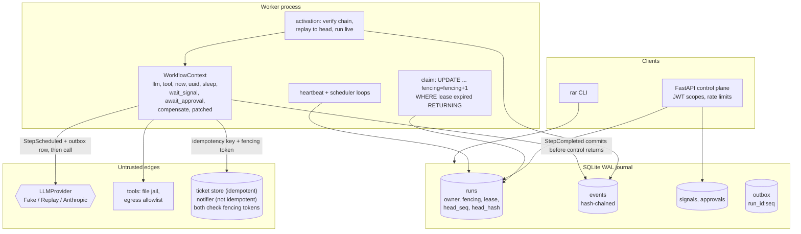
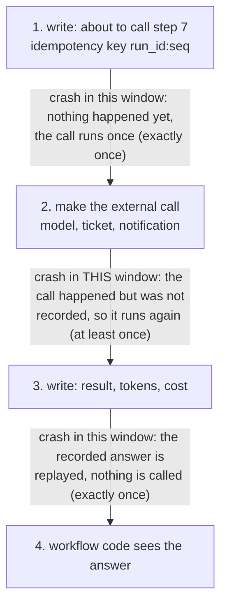

# Replayable Agent Runtime

A runtime for AI agents that writes down every step an agent takes, so when the process running it
is killed the run continues from where it stopped instead of starting over — and never pays for the
same model call twice.

## The problem this solves

Picture an agent that investigates an incident: it reads a few internal documents, asks a language
model what it found, opens a ticket, and pings the on-call engineer. Two things make that run
fragile. It costs real money on every model call, and it has to stop and wait for a human to approve
the ticket — which can take minutes or days.

Most agent frameworks keep that run in the memory of one process. When the process is redeployed,
runs out of memory or is killed, the progress is gone. Starting again from the top means paying for
every model call a second time, and repeating side effects that are not safe to repeat: a second
ticket, a second page to someone's phone at 3 a.m. Worse, a worker that was only *paused* (a long
garbage-collection stop, a `docker pause`, a virtual machine migration) can wake up later believing
it still owns the run and apply its half-finished work on top of the new one.

Three people feel this. Whoever pays the model bill, because the same tokens get billed again.
Whoever is on the receiving end of the duplicated ticket or alert. And whoever has to explain
afterwards what the agent actually did, what it was told, and who approved the part that touched
production — because with no record, nobody can.

This repository is a runtime that removes those failures, the test suite that tries to break it, and
an honest account of the one case it cannot remove.

## What this does

- **Writes down every step before the agent sees the result.** Each model call, tool call, clock
  reading, timer, human approval and failure becomes one line in an append-only log (a *journal*:
  a file you only ever add to, never edit).
- **Resumes a killed run by re-reading that log.** The same code runs again from the top, but every
  step that is already recorded returns its recorded answer instead of calling out again. Past the
  last record, the run continues live. Completed model calls are not paid for twice.
- **Waits for a human on anything with consequences.** A tool that writes to the outside world
  blocks until someone approves that exact call, identified by a fingerprint of its arguments.
  The approver has to be a different person from whoever started the run.
- **Refuses to let an old worker apply stale work.** Each takeover raises a counter (a *fencing
  token*), and the systems being written to reject anything carrying a lower one.
- **Keeps a record that shows if it has been edited.** Every entry seals the one before it with a
  hash, so a changed, deleted or reordered line is detectable, and a run whose log does not verify
  is never replayed.

Five words used throughout:

| Word | Meaning here |
|---|---|
| Journal | Append-only log of everything the run did |
| Replay | Re-running the code, serving recorded answers |
| Fencing token | Counter that invalidates a superseded worker |
| Idempotency key | One-per-request id, so retries apply once |
| Compensation | Undo step, run in reverse on failure |

## Architecture



### How one run flows, in words

1. **Someone starts a run.** A client posts a workflow name and its input to the API. The runtime
   writes a `RunStarted` line, returns a run id, and answers. No agent code has executed yet.
2. **A worker claims it.** The claim is a single atomic database update that raises the run's
   fencing token and takes a time-limited lease. A background thread renews the lease while the
   worker holds it, so slow disk writes on the main loop cannot cost it the run.
3. **The workflow function runs.** It is ordinary async Python. Everything non-deterministic —
   the model, tools, the clock, random ids, sleeping, waiting for a signal — goes through a
   `WorkflowContext` object rather than being called directly.
4. **Each step is written down twice.** Before the call: "step 7, asking the model this exact
   question", with an idempotency key of `run_id:seq`. After it returns: the answer, the token
   usage and the cost. The second write commits *before* the workflow is allowed to see the result.
5. **Anything that writes to the world stops for a human.** The runtime records an approval request
   carrying the hash of the exact arguments. A second person approves that hash through the API or
   CLI. Change one character of the arguments and the approval no longer matches.
6. **The worker dies.** Nothing is lost because nothing lived only in memory. The lease expires,
   another worker claims the run with a higher fencing token, announces that token to the ticket
   store and notifier, verifies the hash chain, and re-runs the workflow from the first line —
   replaying recorded answers, calling nothing — until it reaches the end of the record and carries
   on live.
7. **If the code changed underneath the run**, replay notices: the step being issued no longer
   matches the step that was recorded. The run is *blocked* for an operator rather than continuing
   half-old and half-new. Intentional changes go behind `ctx.patched("id")`, which old histories
   replay cleanly.
8. **On failure or cancellation**, registered compensations run newest first — closing the ticket
   that was opened — and each compensation is itself journaled.

The one gap this design cannot close is drawn below: the moment between an external call returning
and its result reaching the log.



A crash in the middle window repeats that one step. The ticket store deduplicates it by idempotency
key; the notifier, which deliberately has none, delivers twice. [docs/SEMANTICS.md](docs/SEMANTICS.md)
states this precisely; the measurements below count how often it happened.

## Results

Every number here was produced by the command shown, on one machine: Windows 10 (10.0.19045),
Intel64 Family 6 Model 158, 6 logical CPUs, Python 3.12.14, journal on the local disk. They are
single-machine measurements for catching regressions, not performance claims. CI runs the same
scripts with the gates in `bench/thresholds.json`. Each script writes its raw JSON to
`bench/results/`, which is not committed: run it and the file appears.

### Does a crashed run come back correct?

`uv run python bench/eval_suites.py --examples 500 --zombie-trials 10 --check` — printed
"all evaluation gates passed".

| Measured | Result | What it means for you |
|---|---|---|
| 500 randomly generated agent programs, interrupted by 612 injected crashes at every kind of crash point | 500 / 500 recovered runs match an uncrashed run's result and external-effect ledger | A crash did not change the outcome in any of the 500 |
| 417 of those runs, crashed only at commit boundaries | 0 paid model calls repeated | Work you already paid for is not billed again |
| 83 runs crashed inside the window between a call and its record | 23 repeated calls in total, all for the interrupted step | The one honest exception, and it is bounded to one step |
| Journals checked after recovery; recorded clock and uuid values | 500 / 500 verify; 0 values changed on replay | The recovered run sees the same time and the same ids it saw before |

### Can a paused worker apply stale work?

Same command (10 trials per sink and per wake-up ordering).

| Scenario | Result | What it means |
|---|---|---|
| Zombie wakes after the new owner finished, or before its first write | 40 / 40 stale writes rejected, 0 duplicate applications | A superseded worker cannot double-apply |
| Control with sink fencing switched off | 20 / 20 duplicate notifications; ticket store still 0 duplicates | The test can fail — it is not vacuously passing — and idempotency keys alone save only the idempotent sink |
| Claim window: zombie writes between the claim and the token announcement | 10 / 10 notifications delivered twice, 0 / 10 duplicate ticket writes, 20 / 20 zombies fenced out at the journal | The remaining at-least-once window, measured rather than glossed over |

### Does replay catch code changes and tampering?

| Suite | Result | What it means |
|---|---|---|
| Mutation suite | 22 / 22 non-deterministic workflow edits raise `NonDeterminismError` and leave the in-flight run blocked with nothing appended; 4 / 4 edits guarded by `ctx.patched` replay cleanly and finish | Deploying changed code mid-run stops the run instead of corrupting it |
| Tamper suite | Detected 160 / 160 event modifications, 20 / 20 deletions, 19 / 19 reorderings, 3 / 3 tail truncations, 1 / 1 forged append, 3 / 3 edits to the `runs` columns the chain binds, 36 / 36 edits to approval rows, and 12,593 / 12,593 single-byte flips of an exported log | Someone editing the audit record afterwards is detected |

### Does it survive a real `kill -9`?

`uv run python bench/chaos_sigkill.py --seeds 200 --check` — printed "all seeds recovered" after
322.9 s.

| Measured | Result |
|---|---|
| Worker subprocesses SIGKILLed at chosen journal offsets | 200 / 200 killed: 105 right after a commit, 95 right after an external call returned but before its commit |
| Recovery | 200 / 200 runs recovered to the uncrashed outcome; 200 / 200 journals verified; 0 harness errors |
| Repeated paid calls | 0 for kills after a commit; 21 for kills inside the effect window, all for the interrupted step |

Two harness bugs found here are fixed and now covered by tests, and are worth stating because they
were failures of the measuring instrument, not of the runtime. The harness numbered simulated
signals in process memory, so a recovering process restarted the sequence and 5 seeds failed
(`tests/integration/test_chaos_harness.py`). On Windows, the database files of a worker just killed
with `TerminateProcess` could still be held by the OS, so reopening them raised `disk I/O error` and
aborted the whole run without a summary, at seeds 6 and 128; the harness now reopens with
exponential backoff and records a failed seed instead of aborting
(`tests/unit/test_sigkill_harness.py`).

### How fast is the journal?

`uv run python bench/bench_baseline.py --check --markdown BENCHMARKS.md` — printed "all benchmarks
within thresholds". Full table in [BENCHMARKS.md](BENCHMARKS.md).

| Benchmark | runs | p50 (ms) | p95 (ms) |
|---|---:|---:|---:|
| Journal append, `synchronous=NORMAL` (default) | 2000 | 0.796 | 1.299 |
| Journal append, `synchronous=FULL` | 500 | 1.657 | 2.844 |
| Resume a 1,001-event run end to end | 40 | 52.511 | 54.981 |
| Replay to the head of 1,001 events (engine-measured) | 40 | 18.267 | 19.840 |
| Verify the hash chain over 1,001 events | 50 | 14.174 | 14.918 |

Reading the first row: half of the 2,000 journal writes finished within 0.796 ms and 95 in 100
within 1.299 ms, so the safety net costs about a millisecond per step. The slowest single append out
of 2,000 took 19.917 ms. Reading the third row: a run that had already recorded a thousand steps was
claimed, verified, replayed and parked again in about a twentieth of a second — recovery is not
something an operator waits on.

Replay cost grows linearly with history length, which is the central trade-off of this design:

| Events in history | Replay to head, p50 (ms) | Full resume, p50 (ms) |
|---:|---:|---:|
| 101 | 1.817 | 10.309 |
| 501 | 9.223 | 29.633 |
| 1,001 | 18.267 | 52.511 |
| 2,001 | 36.698 | 100.233 |
| 4,001 | 80.950 | 216.430 |

`bench/thresholds.json` gates append p95 below 10 ms and 1,001-event resume p95 below 150 ms in CI.
Because the cost grows, histories are capped (10,000 events by default) and a run above the cap
fails loudly rather than slowing every later activation
([ADR 2](docs/adr/0002-event-sourced-replay-over-state-snapshots.md)).

### Tests, checks and the demo

- `uv run python tasks.py test` runs 422 tests; the last local run reported 94.76% combined line and
  branch coverage against an 85% floor. Locally it uses 60 examples per crash-equivalence property;
  CI sets `RAR_CRASH_EXAMPLES=500`.
- `uv run python tasks.py baseline` passes all 541 checks, which is what keeps this README honest:
  it fails if a file, README section, CI job or piece of evidence referenced in
  [CLAIMS.md](CLAIMS.md) does not exist.
- `uv run python tasks.py demo` (about 12 s) kills a real worker process inside its second
  knowledge-base read, at journal seq 8. After the dead lease expires (about 3 s) a new worker
  resumes with fencing token 4 and repeats 0 provider calls: 2 before the kill,
  5 in total. Both self-approval attempts are refused, `bob` approves, one ticket and one
  notification are written, the 27-event journal verifies, and a one-byte change to an exported copy
  is caught with "payload modified".

## How it works

For engineers. The design follows Temporal's workflow/activity split: workflow code is deterministic
and re-runnable; everything else is an effect that gets recorded.

```python
async def research_ticket(ctx: WorkflowContext, value: JsonValue) -> JsonValue:
    started_at = await ctx.now()  # recorded clock
    result = await run_agent(ctx, task=..., tools=("http_get", "read_file", "create_ticket"))
    for ticket in created_tickets(result):
        ctx.compensate("close_ticket", {"ticket_id": ticket})  # saga rollback
    await ctx.tool("notify", {"channel": "oncall", "message": "..."})  # blocks on approval
    return {...}
```

**Journal and replay.** Each context call is a *command* numbered in issue order. Its events
(`StepScheduled`, `StepCompleted`, `StepFailed`, `CommandRejected`, `TimerScheduled`, `TimerFired`,
`SignalReceived`, `ApprovalRequested`, `ApprovalGranted`, `ApprovalDenied`, `PatchMarker`,
`CancelRequested`) carry `run_id`, `seq`, the command number, a fingerprint (SHA-256 of kind, name
and canonical arguments), the payload digest and `prev_hash`. An activation verifies the chain
against the head anchored in `runs`, then re-runs the workflow: below the head, recorded results are
served and a fingerprint mismatch raises `NonDeterminismError`; past the head, commands run live and
their events commit before the workflow continues.

**Workers and side effects.** Workers claim runs with an atomic, fencing-token-incrementing update
under `BEGIN IMMEDIATE` and renew leases from a heartbeat thread, so journal I/O on the event loop
cannot starve it. Every append is conditional on the lease's owner and token, so a zombie worker
cannot fork the history. Every activation announces its token to the sinks before it replays or
re-executes anything. Side-effecting tools write an outbox row keyed `run_id:seq` in the same
transaction as `StepScheduled`, receive that key and the fencing token, and the bundled sinks refuse
stale tokens. Compensations run newest first on failure or cancellation. `ctx.patched("id")` lets new
code branch without breaking in-flight histories.

**Controls around the model.** Write tools block on a durable approval bound to the exact call hash
and decided by a different principal; tool output returns to the model inside untrusted-data
envelopes; step, token and USD budgets are recomputed from the journal on every activation; a
per-workflow tool allowlist bounds what injected text can reach.

### The key trade-off, and why not the obvious alternative

The obvious alternative is to **snapshot state**: serialize the workflow's variables or coroutine
frame at every wait and restore it later. Python coroutines cannot be serialized safely; doing it
approximately needs pickle (which executes code on load, and ships nowhere in this repo) or a
hand-written state machine per workflow, which gives up plain async code.

Replay keeps workflows as ordinary async functions, at a price: **every activation re-executes the
workflow from the start**, so recovery cost is O(history), as the table above shows. That is
acceptable for runs measured in hundreds of steps and unacceptable for unbounded ones, which is why
the history cap exists and why continue-as-new is named as a non-goal rather than pretended away.
The second consequence is that workflow code must be deterministic, which is why a fingerprint
mismatch blocks the run instead of guessing.

Decisions and their consequences are recorded as ADRs:

| ADR | Decision |
|---|---|
| [0002](docs/adr/0002-event-sourced-replay-over-state-snapshots.md) | Event-sourced replay instead of snapshotting coroutine state |
| [0003](docs/adr/0003-sqlite-wal-synchronous-normal.md) | Single-node SQLite in WAL mode, `synchronous=NORMAL` by default |
| [0004](docs/adr/0004-fencing-tokens-plus-idempotency-keys.md) | Fencing tokens at the journal *and* at sinks, plus idempotency keys |
| [0005](docs/adr/0005-hash-chain-over-payload-digests.md) | Hash-chained events over payload digests, anchored by a stored head |
| [0006](docs/adr/0006-synchronous-journal-io-and-an-out-of-loop-heartbeat.md) | Synchronous journal I/O on the loop, heartbeat on its own thread |

Exact guarantees and crash windows: [docs/SEMANTICS.md](docs/SEMANTICS.md).

```text
src/replayable_agent_runtime/
  runtime/   journal.py context.py engine.py worker.py events.py schema.py migrations/ (Alembic)
             sinks.py builtin_tools.py agent.py examples.py control.py api.py factory.py
             chaos.py sigkill.py zombie.py tamper.py mutations.py (evaluation harnesses)
  agentic/   providers (fake, replay, anthropic), tools, approval, audit, budget, envelope
  core/      settings, redacting logs, tracing, metrics, FastAPI factory, JWT, rate limiting
  demo.py cli.py
tests/unit, tests/integration   bench/   docs/SEMANTICS.md docs/THREAT_MODEL.md docs/adr/
```

## Security

In plain terms: an agent with a credit card and write access is a tempting thing to hijack, and the
text it reads — web pages, tickets, files — is written by other people. The defences assume the
model will be fooled, and put the enforcement outside it. Threats, controls and their tests are in
[docs/THREAT_MODEL.md](docs/THREAT_MODEL.md) (STRIDE, focused on tampering and repudiation); every
claim below links to evidence in [CLAIMS.md](CLAIMS.md).

- **Approvals.** Write tools declare an effect class and block on a durable approval bound to the
  canonical hash of the exact call. The approver must present that hash and be a different principal
  from the run starter. Changed arguments invalidate the approval, and an approvals row edited after
  the decision halts the run without any effect.
- **Prompt injection.** A scripted model that obeys every injected instruction still cannot cause an
  unapproved effect. Calls to tools outside the workflow allowlist, or not offered to the model, are
  rejected and journaled, and tool output is wrapped as untrusted data.
- **Budgets.** Step, token and USD budgets live in the journal, so crashes, resumes, replays and
  looser runtime settings cannot reset or raise them (property-tested).
- **Audit.** The journal is hash-chained and anchored by a stored head; `rar audit verify` and the
  tamper suite detect modification, deletion, reordering, truncation and forged appends, and every
  single-byte flip in an export. Runs whose chain does not verify are never replayed.
- **Zombie workers.** Fencing tokens are checked at the journal and at the sinks, and every
  activation announces its token to the sinks before it runs. The one remaining window — a write
  landing between the claim commit and the announcement — is at-least-once and deduplicated only by
  idempotency keys (docs/SEMANTICS.md).
- **Tools.** The file tool is jailed to its workspace with lexical and `realpath` checks, including
  Windows device names; the HTTP tool only reaches allowlisted hostnames, which resolve to bundled
  in-process fake services.
- **API.** Local-issuer HS256 JWTs with `runs:start`, `runs:signal`, `runs:read` and `runs:approve`
  scopes, failing closed without a secret; per-subject token-bucket rate limits; pydantic and body
  size limits; security headers; PII redaction in logs, history responses, error messages and
  redacted exports; secrets only from the environment.
- **Model provider.** `AnthropicProvider` (default `claude-opus-5`, used only with
  `APP_PROVIDER=anthropic` and a key) sends adaptive thinking, strict tool schemas and the
  server-side refusal fallback, checks `stop_reason` including `refusal` before reading content, and
  maps SDK errors most-specific-first. It is tested against a mocked client only.
- **CI.** ruff, mypy --strict, pytest with an 85% coverage floor (500 crash-equivalence examples),
  benchmark and evaluation gates, the 200-seed SIGKILL chaos job, bandit, semgrep, pip-audit,
  gitleaks, hadolint, trivy, a CycloneDX SBOM and the compose zombie test. Reporting:
  [SECURITY.md](SECURITY.md).

## Quickstart

Everything below runs offline, with no API key and no network access: the model is a scripted fake,
and the ticket store, notifier and HTTP endpoints are in-process fakes. You need
[uv](https://docs.astral.sh/uv/) and Python 3.12.

```bash
uv sync --frozen
uv run python tasks.py demo    # start a run, SIGKILL its worker, resume, approve via CLI, verify
```

**What you will see:** a JSON summary of a run that was killed mid-flight and recovered — the step
the worker died in, provider calls before and after the kill with `duplicate_provider_calls: 0`,
two self-approvals refused and then granted by a second principal, the single ticket and single
notification that were written, and the audit verification of both the journal and a deliberately
tampered export. It takes about twelve seconds, a quarter of which is the wait for the dead worker's
lease to expire.

Then explore further:

```bash
uv run python tasks.py check   # ruff, mypy --strict, pytest + coverage, bandit, pip-audit, baseline
uv run python tasks.py bench   # benchmarks and evaluation suites with regression gates
uv run python tasks.py chaos   # 200 seeds of the SIGKILL chaos harness (several minutes)
```

On Windows with a small repository drive, put the environment elsewhere first:
`$env:UV_PROJECT_ENVIRONMENT = "C:/Users/<you>/.venvs/replayable-agent-runtime"`.

Drive runs from the CLI (direct database access):

```bash
uv run rar runs start --workflow research_ticket --input '{"topic": "cache"}' --as alice
uv run rar worker --until-idle
uv run rar approvals list --status pending          # shows exact arguments and call_hash
uv run rar approvals decide <approval_id> --approve --call-hash <hash> --as bob
uv run rar runs history <run_id>                     # redacted event payloads
uv run rar runs replay-check <run_id>                # strict replay against current code
uv run rar audit verify [--run-id <id> --expect-head <hash>]
uv run rar audit export <run_id> --out run.jsonl [--redact]
```

Or through the HTTP API (embedded worker by default):

```bash
export APP_JWT_SECRET=$(uv run rar generate-secret | python -c "import json,sys; print(json.load(sys.stdin)['jwt_secret'])")
uv run rar serve &
TOKEN=$(uv run rar token --sub alice --scope runs:start runs:read | python -c "import json,sys; print(json.load(sys.stdin)['token'])")
curl -s -H "Authorization: Bearer $TOKEN" -H "Content-Type: application/json" \
     -d '{"workflow": "research_ticket", "input": {"topic": "cache"}}' http://127.0.0.1:8000/v1/runs
```

Routes: `POST /v1/runs` (runs:start), `GET /v1/runs`, `GET /v1/runs/{id}`,
`GET /v1/runs/{id}/history`, `GET /v1/runs/{id}/verify`, `GET /v1/approvals` (runs:read),
`POST /v1/runs/{id}/signals/{name}`, `POST /v1/runs/{id}/cancel` (runs:signal),
`POST /v1/approvals/{id}` (runs:approve), plus `/healthz`, `/readyz` (database, scheduler loop,
lease loop) and `/metrics` (runs:read).

Containers: `docker compose up --build` runs the API and two workers on a shared volume, non-root
with a read-only root filesystem (set `RAR_API_PORT` when host port 8000 is taken). Verified
locally: the image builds to 63.8 MB, `docker run --rm --entrypoint id` reports
`uid=10001(app) gid=10001(app)`, the HEALTHCHECK goes healthy, `/healthz` and `/readyz` answer 200
with the root filesystem read-only, and `docker compose config` validates. hadolint, trivy, the
CycloneDX SBOM and the compose zombie-worker test (`docker pause`/`unpause`) run in CI only.

## Non-goals

What this is not, stated so nobody has to discover it the hard way.

- **Distribution:** single node only. PostgreSQL, workers on several hosts, network filesystems and
  multi-region replication are out of scope (docs/adr/0003-sqlite-wal-synchronous-normal.md).
- **Long histories:** each activation replays from the start. There is no continue-as-new and no
  sticky cache of running workflows; histories are capped (10,000 events by default) and the run
  fails loudly above the cap. Journal appends stay synchronous on the worker's event loop; only the
  heartbeat is moved off it (docs/adr/0006-synchronous-journal-io-and-an-out-of-loop-heartbeat.md
  states when offloading or continue-as-new would become necessary).
- **Retry policies:** failed activities are recorded and re-raised; there are no automatic activity
  retries with backoff (the Anthropic SDK retries transport errors itself). Signal waits have no
  timeout.
- **Exactly-once everywhere:** effects are at-least-once in the crash window between an external
  call and its journal commit, and in the window between a lease claim and the new owner's token
  announcement to the sinks; they are effectively once only at sinks that honour idempotency keys
  and fencing tokens. The bundled notifier deliberately has no idempotency keys to show the
  difference.
- **Power-loss durability by default:** `synchronous=NORMAL` survives killed processes, not power
  loss; `FULL` is one setting away and slower.
- **Tamper-proof audit:** the journal is tamper-*evident*. Someone who can write the database can
  rebuild a consistent chain and head; detecting that needs a head hash stored elsewhere. Heads are
  not signed or published automatically.
- **Real external services:** the HTTP tool reaches only bundled fake services, and the ticket store
  and notifier are fakes in their own SQLite file. DNS rebinding protection for a real transport is
  not implemented.
- **Identity management:** local-issuer HS256 tokens without rotation or revocation; the CLI trusts
  `--as` because it already has database access. Approvals do not expire.
- **Telemetry export:** spans go to the console or nowhere; no OTLP exporter is bundled.
- **Live model evaluation:** tests, demo and benchmarks never call a paid API; no recorded cassettes
  ship.
- **How the chaos harness kills:** workers are killed with SIGKILL at chosen journal offsets (right
  after a commit, or right after an external call returns), not at arbitrary wall-clock instants, and
  recovery runs in the harness process rather than a second subprocess. The compose zombie test (CI
  only, never run locally) pauses a worker during a read, so it checks journal fencing: the paused
  worker's late append is refused. Sink-level fencing against a paused writer, in all three wake-up
  orderings, is covered by the in-process zombie test and the evaluation suite.

## License

[MIT](LICENSE).
