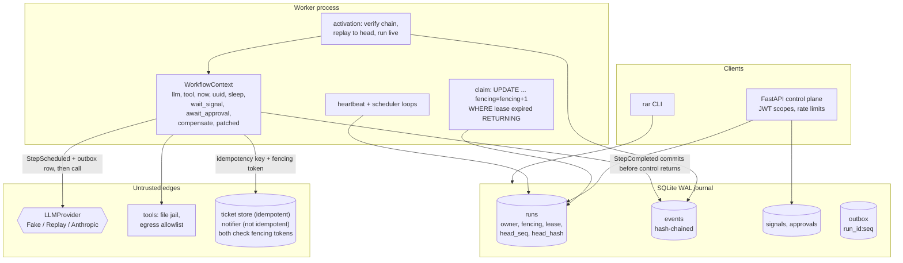

# replayable-agent-runtime

Agent runs that survive `kill -9`. Every LLM call, tool call, timer, signal and human approval is
journaled to a hash-chained SQLite log, and a crashed run resumes by deterministic replay without
paying for any completed call twice.

## Problem

Long-running agent runs often wait hours or days for approvals, but their state lives in process
memory. A deploy, an out-of-memory kill or a crash loses the progress. Retrying naively re-pays LLM
calls and repeats non-idempotent side effects (a second ticket, a second e-mail), and failures that
depend on timing cannot be reproduced.

This repository implements **durable execution** for agent workflows, in the style of Temporal's
workflow/activity split: workflows are plain async Python functions, and everything
nondeterministic goes through a context whose results are recorded before the workflow sees them.

```python
async def research_ticket(ctx: WorkflowContext, value: JsonValue) -> JsonValue:
    started_at = await ctx.now()  # recorded clock
    result = await run_agent(ctx, task=..., tools=("http_get", "read_file", "create_ticket"))
    for ticket in created_tickets(result):
        ctx.compensate("close_ticket", {"ticket_id": ticket})  # saga rollback
    await ctx.tool("notify", {"channel": "oncall", "message": "..."})  # blocks on approval
    return {...}
```

## Architecture



**Journal and replay.** Each context call is a *command* numbered in issue order. Its events
(`StepScheduled`, `StepCompleted`, `StepFailed`, `CommandRejected`, `TimerScheduled`, `TimerFired`,
`SignalReceived`, `ApprovalRequested`, `ApprovalGranted`, `ApprovalDenied`, `PatchMarker`,
`CancelRequested`) carry `run_id`, `seq`, the command number, a fingerprint (SHA-256 of kind, name and
canonical arguments), the payload digest and `prev_hash`. An activation verifies the chain against
the head anchored in `runs`, then re-runs the workflow: below the head, recorded results are served
and a fingerprint mismatch raises `NonDeterminismError` (the run is blocked for an operator); past
the head, commands run live and their events commit before the workflow continues.

**Workers and side effects.** Workers claim runs with an atomic, fencing-token-incrementing update
under `BEGIN IMMEDIATE` and renew leases from a heartbeat thread, so journal I/O on the event loop
cannot starve it. Every append is conditional on the lease's owner and token, so a zombie worker
cannot fork the history. Every activation announces its token to the sinks before it replays or
re-executes anything. Side-effecting tools write an outbox row keyed `run_id:seq` in the same
transaction as `StepScheduled`, receive that idempotency key and the fencing token, and the bundled
sinks refuse stale tokens. Compensations registered with `ctx.compensate` run newest first on
failure or cancellation. `ctx.patched("id")` lets new code branch without breaking in-flight
histories.

**Controls around the model.** Write tools block on a durable approval bound to the exact call hash
and decided by a different principal; tool output returns to the model inside untrusted-data
envelopes; step, token and USD budgets are recomputed from the journal on every activation; a
per-workflow tool allowlist and the set of tools exposed to the model bound what injected text can
reach.

Guarantees and crash windows are specified in [docs/SEMANTICS.md](docs/SEMANTICS.md); design
trade-offs are in [docs/adr/](docs/adr/).

```text
src/replayable_agent_runtime/
  runtime/   journal.py context.py engine.py worker.py events.py schema.py migrations/ (Alembic)
             sinks.py builtin_tools.py agent.py examples.py control.py api.py factory.py
             chaos.py sigkill.py zombie.py tamper.py mutations.py (evaluation harnesses)
  agentic/   providers (fake, replay, anthropic), tools, approval, audit, budget, envelope
  core/      settings, redacting logs, tracing, metrics, FastAPI factory, JWT, rate limiting
  demo.py cli.py
tests/unit, tests/integration   bench/   docs/SEMANTICS.md docs/THREAT_MODEL.md docs/adr/
```

## Quickstart

Requirements: [uv](https://docs.astral.sh/uv/) and Python 3.12. Nothing below needs an API key or
network access.

```bash
uv sync --frozen
uv run python tasks.py demo    # start a run, SIGKILL its worker, resume, approve via CLI, verify
uv run python tasks.py check   # ruff, mypy --strict, pytest + coverage, bandit, pip-audit, baseline
uv run python tasks.py bench   # benchmarks and evaluation suites with regression gates
uv run python tasks.py chaos   # 200 seeds of the SIGKILL chaos harness (several minutes)
```

On Windows with a small repository drive, keep the environment elsewhere first:
`$env:UV_PROJECT_ENVIRONMENT = "C:/Users/<you>/.venvs/replayable-agent-runtime"`.

The demo prints a JSON summary: which step the worker was killed in, provider calls before and after
the kill (`duplicate_provider_calls` is 0), the approvals (self-approval refused, approved by `bob`),
the ticket and notification written, and the audit verification of the journal and of a tampered
export.

Operate runs from the CLI (local database access):

```bash
uv run rar runs start --workflow research_ticket --input '{"topic": "cache"}' --as alice
uv run rar worker --until-idle
uv run rar approvals list --status pending          # shows exact arguments and call_hash
uv run rar approvals decide <approval_id> --approve --call-hash <hash> --as bob
uv run rar runs history <run_id>                     # redacted event payloads
uv run rar runs replay-check <run_id>                # strict replay against current code
uv run rar audit verify [--run-id <id> --expect-head <hash>]
uv run rar audit export <run_id> --out run.jsonl [--redact]
```

Or through the API (embedded worker by default):

```bash
export APP_JWT_SECRET=$(uv run rar generate-secret | python -c "import json,sys; print(json.load(sys.stdin)['jwt_secret'])")
uv run rar serve &
TOKEN=$(uv run rar token --sub alice --scope runs:start runs:read | python -c "import json,sys; print(json.load(sys.stdin)['token'])")
curl -s -H "Authorization: Bearer $TOKEN" -H "Content-Type: application/json" \
     -d '{"workflow": "research_ticket", "input": {"topic": "cache"}}' http://127.0.0.1:8000/v1/runs
```

Routes: `POST /v1/runs` (runs:start), `GET /v1/runs`, `GET /v1/runs/{id}`, `GET /v1/runs/{id}/history`,
`GET /v1/runs/{id}/verify`, `GET /v1/approvals` (runs:read), `POST /v1/runs/{id}/signals/{name}`,
`POST /v1/runs/{id}/cancel` (runs:signal), `POST /v1/approvals/{id}` (runs:approve), plus `/healthz`,
`/readyz` (database, scheduler loop, lease loop) and `/metrics` (runs:read).

Containers: `docker compose up --build` runs the API and two workers on a shared volume, non-root
with a read-only root filesystem. Image build, smoke test, trivy, SBOM and the compose zombie-worker
test (`docker pause`/`unpause`) run in CI only; Docker was not run while building this repository.

## Results

All numbers come from the commands shown, run on one machine: Windows 10 (10.0.19045), Intel64
Family 6 Model 158, 6 logical CPUs, Python 3.12.14, journal on the local disk. They are
single-machine measurements for regression tracking, not performance claims; CI runs the same
scripts with the gates and thresholds in `bench/`.

**Durable execution** (`uv run python bench/eval_suites.py --examples 500 --zombie-trials 10 --check`,
which printed "all evaluation gates passed"):

| Suite | Result |
|---|---|
| Crash equivalence: 500 random programs, 612 injected crashes (before a commit, after a commit, after an external call) | 500/500 recovered runs match the uncrashed run. 417 runs crashed only at commit boundaries and match exactly (result and external-effect ledger); 83 runs crashed inside an effect window and match except for re-delivery of the interrupted step by the non-idempotent notifier |
| Paid provider calls repeated after recovery | 0 for crashes at commit boundaries; 23 in total for steps interrupted inside their crash window |
| Journals verified after recovery; recorded clock and uuid values | 500/500 verified; 0 values changed on replay |
| Zombie worker, 10 trials per sink | 20/20 stale-token writes rejected with fencing, 0 duplicate applications. Control without sink fencing: 10/10 duplicate notifications; the ticket store still deduplicated by idempotency key (0 duplicates) |
| Mutation suite | 20/20 nondeterministic workflow edits raise `NonDeterminismError`; 4/4 edits guarded by `ctx.patched` replay cleanly |
| Tamper suite | Detected 160/160 column modifications, 20/20 deletions, 19/19 reorderings, 3/3 tail truncations, 1/1 forged append and 12,593/12,593 single-byte flips of an export |

**SIGKILL chaos** (`uv run python bench/chaos_sigkill.py --seeds 200 --check`, which printed "all
seeds recovered" after 313 s): 200 of 200 worker processes were killed, 105 right after a journal
commit and 95 right after an external call returned but before its completion was committed.
200/200 runs recovered to the uncrashed outcome and 200/200 journals verified. Kills right after a
commit repeated 0 paid provider calls; kills inside an effect window repeated 21, all for the
interrupted steps. An earlier 200-seed run failed 5 seeds. The cause was the harness, which numbered
the signals it sends in process memory, so a recovering process restarted the sequence. The fix
numbers them from the journal, and `tests/integration/test_chaos_harness.py` covers it.

**Journal and replay performance** (`uv run python bench/bench_baseline.py --check --markdown BENCHMARKS.md`,
which printed "all benchmarks within thresholds"; full table in [BENCHMARKS.md](BENCHMARKS.md)):

| benchmark | runs | p50 (ms) | p95 (ms) |
|---|---:|---:|---:|
| journal append, `synchronous=NORMAL` (default) | 2000 | 0.808 | 1.855 |
| journal append, `synchronous=FULL` | 500 | 1.647 | 3.051 |
| resume a 1,001-event run (claim, load, verify chain, replay, park) | 40 | 55.202 | 57.604 |
| replay to head, 1,001 events (engine-measured) | 40 | 19.722 | 21.124 |
| verify the hash chain, 1,001 events | 50 | 15.213 | 16.299 |

The specification's targets are append p95 below 10 ms and 1k-event resume below 150 ms;
`bench/thresholds.json` enforces both in CI. Replay grows linearly with history length: p50
replay-to-head was 1.8 ms at 101 events, 9.9 ms at 501, 19.7 ms at 1,001, 38.7 ms at 2,001 and
78.1 ms at 4,001 (full resume 9.9, 29.7, 55.2, 104.5 and 206.2 ms), which is why histories are
capped (docs/adr/0002-event-sourced-replay-over-state-snapshots.md). The largest single append over
2,000 runs took 24.4 ms.

**Tests, static checks and demo.**

- `uv run python tasks.py test`: 376 passed and 2 skipped, with 94.86% line and branch coverage
  against an 85% floor, in 87 s. One skipped test needs symlink rights on Windows; the other only
  applies to the template repository. This local run used 60 examples per crash-equivalence
  property; CI sets `RAR_CRASH_EXAMPLES=500`.
- `uv run python tasks.py lint typecheck audit baseline`: ruff clean, mypy --strict clean on 95
  files, bandit reports no issues, pip-audit finds no known vulnerabilities, and the baseline check
  passes all 482 checks.
- `uv run python tasks.py demo`: the worker is killed inside its second knowledge-base read at
  journal seq 8. After the dead lease expires (3.05 s), a new worker resumes with fencing token 4.
  It repeats 0 provider calls: 2 before the kill, 5 in total. Both self-approvals are refused, one
  ticket and one notification are written, and the 27-event journal verifies. A one-byte change to
  an exported copy is detected ("payload modified").

## Security

Threats, controls and tests are in [docs/THREAT_MODEL.md](docs/THREAT_MODEL.md); every claim below
links to evidence in [CLAIMS.md](CLAIMS.md).

- **Approvals:** write tools declare an effect class and block on a durable approval bound to the
  canonical hash of the exact call. The approver must present that hash and be a different principal
  from the run starter. Changed arguments invalidate the approval, and an approvals row edited after
  the decision halts the run without any effect.
- **Prompt injection:** a scripted model that obeys every injected instruction still cannot cause an
  unapproved effect. Calls to tools outside the workflow allowlist or not offered to the model are
  rejected and journaled, and tool output is wrapped as untrusted data.
- **Budgets:** step, token and USD budgets live in the journal, so crashes, resumes, replays and
  looser runtime settings cannot reset or raise them (property-tested).
- **Audit:** the journal is hash-chained and anchored by a stored head; `rar audit verify` and the
  tamper suite detect modification, deletion, reordering, truncation and forged appends, and every
  single-byte flip in an export. Runs whose chain does not verify are never replayed.
- **Zombie workers:** fencing tokens are checked at the journal and at the sinks, and every
  activation announces its token to the sinks before it runs. Stale-token writes are rejected
  whether the zombie wakes after the new owner finished or before the owner's first write; a
  control run without sink fencing shows the duplicate in both orderings. The one remaining window,
  a write landing between the claim commit and the announcement, is at least once and deduplicated
  only by idempotency keys (docs/SEMANTICS.md).
- **Tools:** the file tool is jailed to its workspace with lexical and `realpath` checks; the HTTP
  tool only reaches allowlisted hostnames, which resolve to bundled in-process fake services.
- **API:** local-issuer HS256 JWTs with `runs:start`, `runs:signal`, `runs:read` and `runs:approve`
  scopes, failing closed without a secret; per-subject token-bucket rate limits; pydantic and body
  size limits; security headers; PII redaction in logs, history responses, error messages and
  redacted exports; secrets only from the environment.
- **Claude:** `AnthropicProvider` (default `claude-opus-5`, only with `APP_PROVIDER=anthropic` and a
  key) sends adaptive thinking, strict tool schemas and the server-side refusal fallback
  (`fallbacks="default"`), checks `stop_reason` including `refusal` before reading content, and maps
  SDK errors most-specific-first. It is tested against a mocked client only.
- **CI:** ruff, mypy --strict, pytest with an 85% coverage floor (500 crash-equivalence examples),
  benchmark and evaluation gates, the 200-seed SIGKILL chaos job, bandit, semgrep, pip-audit,
  gitleaks, hadolint, trivy, a CycloneDX SBOM and the compose zombie test. See
  [SECURITY.md](SECURITY.md) for reporting.

## Non-goals

- **Distribution:** single node only. PostgreSQL, workers on several hosts, network filesystems and
  multi-region replication are out of scope (docs/adr/0003-sqlite-wal-synchronous-normal.md).
- **Long histories:** each activation replays from the start. There is no continue-as-new and no
  sticky cache of running workflows; histories are capped (10,000 events by default) and the run
  fails loudly above the cap. Journal appends stay synchronous on the worker's event loop; only the
  heartbeat is moved off it (docs/adr/0006-synchronous-journal-io-and-an-out-of-loop-heartbeat.md
  states when offloading or continue-as-new would become necessary).
- **Retry policies:** failed activities are recorded and re-raised; there are no automatic
  activity retries with backoff (the Anthropic SDK retries transport errors itself). Signal waits
  have no timeout.
- **Exactly-once everywhere:** effects are at-least-once in the crash window between an external
  call and its journal commit, and in the window between a lease claim and the new owner's token
  announcement to the sinks; they are effectively once only at sinks that honour idempotency keys
  and fencing tokens. The bundled notifier deliberately has no idempotency keys to show the
  difference.
- **Power-loss durability by default:** `synchronous=NORMAL` survives killed processes, not power
  loss; `FULL` is one setting away and slower.
- **Tamper-proof audit:** the journal is tamper-evident. Someone who can write the database can
  rebuild a consistent chain and head; detecting that needs a head hash stored elsewhere. Heads are
  not signed or published automatically.
- **Real external services:** the HTTP tool reaches only bundled fake services, and the ticket store
  and notifier are fakes in their own SQLite file. DNS rebinding protection for a real transport is
  not implemented.
- **Identity management:** local-issuer HS256 tokens without rotation or revocation; the CLI trusts
  `--as` because it already has database access. Approvals do not expire.
- **Telemetry export:** spans go to the console or nowhere; no OTLP exporter is bundled.
- **Live model evaluation:** tests, demo and benchmarks never call a paid API; no recorded cassettes
  ship, and the template's cassette recording task was removed.
- **How the chaos harness kills:** workers are killed with SIGKILL at chosen journal offsets (right
  after a commit, or right after an external call returns), not at arbitrary wall-clock instants, and
  recovery runs in the harness process rather than a second subprocess. The compose zombie test (CI
  only, never run locally) pauses a worker during a read, so it checks journal fencing: the paused
  worker's late append is refused. Sink-level fencing against a paused writer, in all three wake-up
  orderings, is covered by the in-process zombie test and the evaluation suite.
