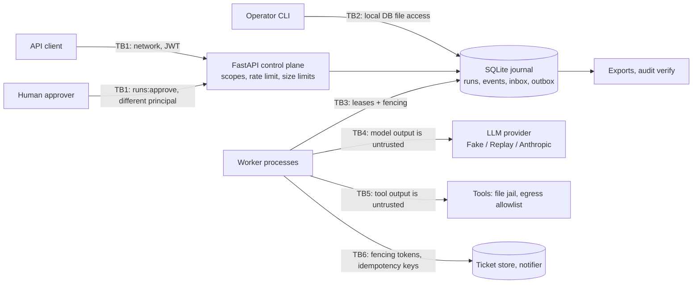

# Threat model

Method: STRIDE per trust boundary, with a focus on **tampering** and **repudiation**: the journal is
both the source of truth for replay and the record of what agents did, what they paid for and who
approved their side effects. Each row maps a threat to the control that addresses it and to the
test, bench script or CI job that shows the control works. `scripts/check_baseline.py` verifies that
every backticked evidence reference exists.

## System and trust boundaries

**Assets:** the integrity and order of journal events; external side effects (tickets,
notifications) and their exactly-once or at-least-once guarantees; approval decisions and who made
them; spend (steps, tokens, USD); the JWT signing secret and provider credentials; personal data in
prompts, tool output, logs and exports.

**Assumptions:** TLS terminates in front of the API; the host, container runtime and filesystem are
trusted; all workers run on one host (one clock, one SQLite file). **Write access to the journal
database file is equivalent to full control of the runtime** (it can rewrite history and approvals);
the controls below make that tampering *evident*, not impossible.

## STRIDE table

| ID | STRIDE | Threat | Entry point / asset | Control | Test / evidence | Residual risk |
|---|---|---|---|---|---|---|
| S1 | Spoofing | Caller forges or replays a token, uses `alg: none` or another algorithm, or a token for another audience or issuer | TB1 | HS256 only; `exp`, `iat`, `nbf`, `sub`, `iss`, `aud`, `jti` required; issuer and audience checked; 32-byte minimum secret from the environment; fail closed without a secret | `tests/unit/test_security.py::test_algorithm_confusion_none_and_missing_claims_are_refused`, `tests/unit/test_security.py::test_expired_future_and_foreign_tokens_are_refused`, `tests/unit/test_security.py::test_without_a_secret_everything_fails_closed`, `tests/integration/test_api.py::test_without_a_signing_secret_every_protected_route_is_unauthorized` | Symmetric secret: anyone holding it can mint tokens; no revocation list (short TTL instead) |
| S2 | Spoofing | The run starter (or its agent) approves its own side effect, possibly after editing `runs.started_by` or `approvals.requested_by` | TB1, approvals | Approver must differ from the starter recorded in the hash-chained `RunStarted` event; inside the decision transaction the whole chain is verified and the `runs` and `approvals` rows must match `RunStarted` and `ApprovalRequested`; the engine refuses a decision made by the chained starter | `tests/integration/test_api.py::test_the_control_plane_drives_a_run_through_scoped_approvals`, `tests/integration/test_approvals_injection.py::test_only_a_different_principal_presenting_the_exact_call_hash_can_approve`, `tests/unit/test_journal.py::test_approval_decisions_enforce_separation_of_duties_and_the_pending_hash`, `tests/unit/test_journal.py::test_separation_of_duties_uses_the_chained_starter_and_request`, `tests/integration/test_approvals_injection.py::test_a_decision_forged_in_the_database_for_the_run_starter_halts_the_run` | Two colluding principals can still approve; the CLI trusts `--as` because it already has DB access (TB2) |
| S3 | Spoofing | Tool output forges an untrusted-data envelope that claims a trusted source | TB5, prompts | Reversible escaping; envelope id derived from SHA-256 of source and content; tool results always wrapped | `tests/unit/test_envelope.py::test_a_forged_envelope_inside_content_is_neutralized`, `tests/integration/test_approvals_injection.py::test_a_gullible_model_obeying_injected_text_causes_no_unapproved_effect` | Envelopes help the model; the enforcing controls are E1-E3 |
| T1 | Tampering | Journal events edited, deleted, reordered, inserted or truncated in the database | Journal file | Each event commits to its payload digest and predecessor; head seq and hash updated in the same transaction as each append; activations verify before replaying and block on failure | `tests/integration/test_tamper_suite.py::test_every_modification_deletion_reordering_truncation_and_forgery_is_detected`, `tests/integration/test_replay.py::test_a_tampered_journal_is_never_replayed`, `bench/eval_suites.py` | An attacker who rewrites the whole chain and the head is caught only by an external anchor (T2) |
| T2 | Tampering | Whole history and head rewritten consistently; exported copies altered | Journal file, exports | `rar audit verify --expect-head` against an externally stored head; full exports verify every byte; redacted exports still verify linkage | `tests/integration/test_tamper_suite.py::test_rewriting_the_whole_chain_and_its_head_needs_an_external_anchor`, `tests/integration/test_tamper_suite.py::test_single_byte_flips_anywhere_in_an_export_are_detected`, `tests/integration/test_tamper_suite.py::test_a_redacted_export_proves_the_chain_but_not_the_payloads` | Heads are not signed or published automatically; operators must store them |
| T3 | Tampering | An approval is edited after it was granted so that it releases different arguments; run columns (`runs.input_json`, `workflow`, `started_by`) are edited so the run executes something its chain does not record | Approvals and runs tables | Stored arguments must hash to the stored call hash, which must equal the hash in the chained `ApprovalRequested` event and the hash of the call being executed; mismatch halts the run (blocked) with no effect. The engine executes the workflow, input and starter from the verified `RunStarted` event and blocks a run whose `runs` row disagrees; `rar audit verify` and the tamper suite check both tables against the chain | `tests/integration/test_approvals_injection.py::test_an_approval_edited_after_it_was_granted_halts_the_run_without_any_effect`, `tests/unit/test_journal.py::test_an_edited_approval_row_cannot_be_approved`, `tests/integration/test_tamper_suite.py::test_run_columns_outside_the_chain_are_verified_and_never_executed`, `tests/unit/test_journal.py::test_verify_run_checks_approval_rows_against_their_chained_requests` | A decision that is not yet journaled lives only in the approvals row: a database writer can mark a pending approval as decided by a third principal (write access is full control; see Assumptions) |
| T4 | Tampering | Arguments changed between approval and execution, or approval presented for a different call | TB1, approvals | Approver must present the pending call hash; changed arguments give a different fingerprint (nondeterminism) or a different call hash; validated arguments round-trip through their canonical form | `tests/integration/test_approvals_injection.py::test_only_a_different_principal_presenting_the_exact_call_hash_can_approve`, `tests/unit/test_tools.py::test_valid_calls_are_canonicalized_bound_to_their_hash_and_runnable`, `tests/unit/test_tools.py::test_argument_models_that_do_not_round_trip_are_refused` | An approver can approve a malicious call they did not read; the approval list shows exact arguments |
| T5 | Tampering | A paused or partitioned zombie worker writes after its lease was reclaimed (journal fork, stale sink write) | TB3, TB6 | Monotonic fencing tokens from atomic claims; every append conditional on owner and token; sinks refuse lower tokens | `tests/integration/test_zombie.py::test_a_paused_zombie_worker_cannot_apply_a_stale_write`, `tests/integration/test_zombie.py::test_the_control_without_fencing_shows_the_zombie_duplicating_a_notification`, `tests/unit/test_journal.py::test_fencing_tokens_strictly_increase_and_only_the_latest_lease_appends`, `.github/workflows/ci.yml#compose-zombie` | Third-party sinks that ignore fencing tokens rely on idempotency keys alone |
| T6 | Tampering | Workflow code changes alter in-flight runs silently (new arguments, skipped steps) | Deployments | Command fingerprints compared on replay; mismatch blocks the run; changes go behind `ctx.patched` | `tests/integration/test_mutation_suite.py::test_every_unguarded_edit_raises_and_blocks_in_flight_runs_and_patched_edits_replay`, `tests/integration/test_replay.py::test_new_code_that_raises_before_the_head_blocks_the_run_instead_of_failing_it`, `tests/integration/test_replay.py::test_nondeterministic_code_blocks_the_run_until_an_operator_retries` | Nondeterminism that does not change issued commands (for example in pure computation on results) is not detected |
| T7 | Tampering | Compromised dependency, base image or CI action | Build pipeline | uv.lock with hashes; pip-audit; base images pinned by digest; trivy; CycloneDX SBOM; Dependabot | `.github/workflows/ci.yml#pip-audit`, `.github/workflows/ci.yml#docker` | Actions are tag-pinned until SHA pinning at publish time |
| R1 | Repudiation | Dispute over what an agent did, what it was told, what it paid or who approved it | Journal | Every model call (request hash, response, usage, cost), tool call (call hash, output), rejection, approval request and decision (with principal), signal (with sender), cancellation and result is a chained event; `rar runs history` and exports | `tests/integration/test_replay.py::test_a_run_journals_every_command_and_strict_replay_calls_nothing`, `tests/integration/test_replay.py::test_signals_are_consumed_in_order_and_journaled`, `tests/integration/test_approvals_injection.py::test_a_gullible_model_obeying_injected_text_causes_no_unapproved_effect` | Timestamps come from the worker clock and are not independently notarized |
| R2 | Repudiation | Spend disputed or budgets reset by restarting or moving a run | Budgets | Limits in the chained `RunStarted` event; spend folded from the run's own events on every activation; runtime caps only tighten | `tests/integration/test_run_budget.py::test_budgets_are_never_reset_by_crashes_resumes_or_replays`, `tests/integration/test_run_budget.py::test_a_looser_runtime_cap_cannot_raise_recorded_limits_but_a_tighter_one_applies`, `tests/unit/test_rules.py::test_the_budget_fold_charges_each_scheduled_step_once` | One model call can overshoot the token or USD limit |
| I1 | Information disclosure | Personal data or secrets from prompts, tool output or errors written to logs, API history, exports or run errors | Logs, API, exports | structlog redaction (after traceback formatting); history API and redacted exports pass payloads through redaction; workflow error messages redacted and truncated; tool failures journaled without exception text | `tests/unit/test_logging.py::test_exception_tracebacks_are_redacted`, `tests/unit/test_redaction.py::test_known_secret_and_pii_formats_are_redacted`, `tests/integration/test_tamper_suite.py::test_a_redacted_export_proves_the_chain_but_not_the_payloads`, `tests/integration/test_replay.py::test_failures_run_compensations_in_reverse_order_and_redact_errors`, `tests/integration/test_replay.py::test_tool_failures_are_journaled_without_internal_details` | The journal itself stores full payloads (replay needs them): protect the database file; redaction is pattern-based |
| I2 | Information disclosure | Error bodies leak exception text, validation input or internals | TB1 | Fixed error codes and messages; validation details without input; readiness reports check names only | `tests/integration/test_api.py::test_input_validation_size_limits_and_unknown_resources`, `tests/integration/test_api.py::test_readiness_checks_the_database_scheduler_and_lease_loops` | None known |
| I3 | Information disclosure | The file tool reads outside its workspace (traversal, absolute or UNC paths, symlinks) | TB5 | Lexical checks, then `realpath` containment in the workspace; size limit | `tests/unit/test_tools.py::test_the_file_jail_refuses_paths_that_leave_the_workspace`, `tests/unit/test_tools.py::test_symlinks_that_resolve_outside_the_workspace_are_refused` | Symlink test skipped where the OS forbids creating symlinks (Windows without developer mode) |
| I4 | Information disclosure | The HTTP tool exfiltrates data or reaches internal services (SSRF) | TB5 | Exact hostname allowlist; no IP literals, credentials, backslashes or non-default ports; allowlisted hosts route to in-process fake services | `tests/unit/test_tools.py::test_egress_is_limited_to_exact_allowlisted_hosts`, `tests/unit/test_config.py::test_egress_allowlist_entries_must_be_plain_hostnames` | A real transport would additionally need DNS rebinding protection; not implemented (fake services only) |
| I5 | Information disclosure | Secrets committed or exposed in configuration | Git, settings | Secrets only from environment as `SecretStr`; only `.env.example` committed; gitleaks and semgrep secrets pack | `tests/unit/test_security.py::test_secrets_must_be_long_and_come_from_settings`, `.github/workflows/ci.yml#gitleaks`, `.github/workflows/ci.yml#semgrep` | Scanners miss unusual formats |
| D1 | Denial of service | Request floods or oversized bodies and inputs | TB1 | Token bucket per verified JWT subject or per client address (IPv6 /64); invalid tokens share the address bucket; body and input size limits | `tests/integration/test_api.py::test_rate_limits_apply_per_token_subject`, `tests/unit/test_middleware.py::test_ipv6_clients_are_limited_per_64_prefix`, `tests/integration/test_api.py::test_input_validation_size_limits_and_unknown_resources` | In-process buckets; SQLite serializes writers, so a write flood slows every run |
| D2 | Denial of service | Runaway agents burn money, or a run's history grows until every replay is slow | Workers | Persisted step, token and USD budgets; history cap fails the run loudly and still rolls back its effects in a bounded reserve; replay time benchmarked | `tests/integration/test_run_budget.py::test_the_step_budget_stops_the_run_and_the_rejection_is_journaled`, `tests/integration/test_replay.py::test_the_history_cap_fails_the_run_loudly`, `tests/integration/test_replay.py::test_hitting_the_history_cap_still_runs_registered_compensations`, `bench/bench_baseline.py` | Continue-as-new is not implemented; long processes must be split by the author |
| D3 | Denial of service | A crashed worker holds a run forever; lost wake-ups strand runs | TB3 | Leases expire and are reclaimed; inbox version comparison on suspend; `/readyz` checks scheduler and lease loops | `tests/unit/test_journal.py::test_claims_increment_fencing_monotonically_and_respect_leases`, `tests/unit/test_journal.py::test_inputs_arriving_during_an_activation_wake_the_run_instead_of_being_lost`, `tests/integration/test_chaos_sigkill.py::test_a_sigkilled_worker_recovers_to_the_uncrashed_outcome`, `.github/workflows/ci.yml#chaos` | Recovery waits for the lease to expire (30 s default) |
| D4 | Denial of service | Container exhausts host resources | Runtime | Compose memory, CPU and PID limits | `.github/workflows/ci.yml#docker` | Limits are deployment-specific |
| E1 | Elevation of privilege | Prompt injection makes the model call a write tool, a tool it was not offered, or a tool outside the workflow | TB4, TB5 | Per-workflow allowlist; separate set of tools exposed to the model; write tools block on hash-bound approval; rejections journaled; tested with a model that always obeys injections | `tests/integration/test_approvals_injection.py::test_a_gullible_model_obeying_injected_text_causes_no_unapproved_effect`, `tests/integration/test_approvals_injection.py::test_allowlists_and_compensation_only_tools_are_enforced_and_journaled` | A human can still approve a malicious call |
| E2 | Elevation of privilege | A tool declared as read-only performs writes, opts out of approval, or a compensation tool is called directly | Tool registry | Effect classes validated at registration (write capabilities cannot claim `read`; `write` cannot opt out; `compensate` only via `ctx.compensate`) | `tests/unit/test_tools.py::test_effect_classes_decide_approval_and_cannot_be_misdeclared`, `tests/integration/test_approvals_injection.py::test_allowlists_and_compensation_only_tools_are_enforced_and_journaled` | Handlers must honestly declare their effects; the registry cannot inspect code |
| E3 | Elevation of privilege | A token with a narrow scope performs privileged operations | TB1 | Per-route scopes (`runs:start`, `runs:signal`, `runs:read`, `runs:approve`); metrics need `runs:read` | `tests/integration/test_api.py::test_routes_fail_closed_without_a_valid_token_or_scope`, `tests/integration/test_api.py::test_metrics_require_the_read_scope_and_expose_runtime_metrics` | Scopes are coarse (no per-workflow scopes) |
| E4 | Elevation of privilege | Code execution inside the container escalates | Runtime | Non-root UID 10001; read-only root filesystem; all capabilities dropped; no-new-privileges | `.github/workflows/ci.yml#docker` | Kernel or runtime vulnerabilities |
| E5 | Elevation of privilege | After a server-side refusal fallback, a tool call from the declined attempt is executed | TB4, AnthropicProvider | `tool_use` and thinking blocks before the last `fallback` marker are dropped; executed calls must equal echoed content | `tests/unit/test_anthropic_provider.py::test_blocks_of_a_declined_attempt_before_the_fallback_marker_are_dropped`, `tests/unit/test_providers.py::test_response_content_must_agree_with_tool_calls` | Verified against a mocked client only |
| E6 | Elevation of privilege | Deserialization of stored state executes code | Journal, sinks | JSON and SQLite only; pickle-family imports banned by tests, the baseline check and semgrep | `tests/unit/test_no_pickle.py::test_source_tree_has_no_pickle_family_serialization`, `.github/workflows/ci.yml#semgrep` | Third-party libraries may deserialize unsafely on their own paths |

## Out of scope

Attackers with write access to the host, the container runtime or the journal database file
(beyond making their tampering evident); network attacks below TLS; multi-tenant isolation;
multi-host deployments (clock skew, network filesystems); key management services and token
revocation.
